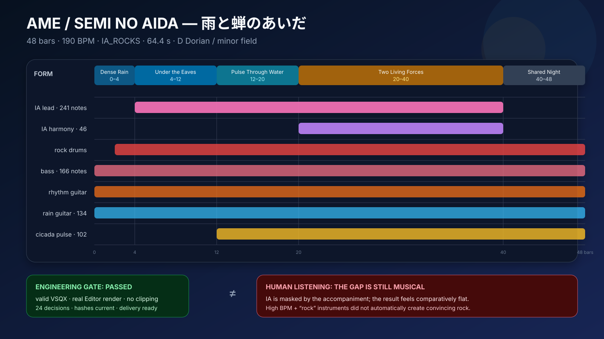

# VOCALOID MCP

> An agent-native production bridge for composing, tuning, rendering, mixing, and auditing native VOCALOID3/4 projects — built **just for fun**.



This repository lets a coding agent begin with an empty timeline or a creative brief and work through:

```text
intent
  → theory / form / harmony / melody
  → Japanese note allocation
  → native IA delivery
  → arrangement
  → original VOCALOID3 Editor rendering
  → isolated stems / mix / master / QC
  → VSQX + hash-bound creative record
```

It is not a MIDI-to-VSQX converter and it is not a one-button hit-song generator. Notes, lyrics, phonemes, note expression, vibrato, and VOCALOID control curves compile into native VSQ3/VSQ4 structures. The licensed original Editor remains the synthesis authority.

The project has proven that an agent can be a useful composer assistant, production engineer, and experiment partner. It has **not** engineered taste or the “perfect song.” Our latest technically valid 190 BPM IA_ROCKS test still received the honest human verdict: the vocal was masked by the accompaniment, and the result did not really feel like rock.

That distinction is a feature.

## What is actually proven

- Create native VSQ3/VSQ4 projects from zero, without copying a source project.
- Validate with Yamaha's schemas and a hash-pinned native `Vsq3.dll` loader probe.
- Render the selected locally licensed singer through the original VOCALOID3 Editor.
- Fail closed on singer substitution and suspicious cross-component probe collisions.
- Author Japanese lyrics with explicit kana readings, manual-backed phonemes, mora allocation, rests, melisma, and small-`っ` timing choices.
- Compile high-level articulation, dynamics, timbre, vibrato, and pitch gestures into native note styles and control curves.
- Maintain a revisioned canonical song manifest with stable IDs, dry-runs, bounded edits, history, and separate content/composition/mix hashes.
- Render multi-instrument accompaniment, isolated vocal/instrument stems, deterministic effect chains, section automation, mixes, previews, A/B pairs, and masters.
- Measure LUFS, LRA, sample/true peak, clipping, channel balance, score/render pitch, timing, release, and vibrato evidence.
- Run deterministic music-theory and arrangement diagnostics without letting rules or corpus data compose the next note.
- Preserve concise, hash-chained creative decisions across:

  ```text
  intent → theory → note allocation → IA delivery → arrangement
  ```

- Transfer the workflow to genuinely fresh Codex sessions using one fixed prompt plus one strict per-song intent file.

Current automated result:

```text
102 tests discovered
100 passed
2 intentionally skipped by environment
0 failed
```

## The important non-claim

Passing every engineering gate does not mean a song is musically successful.

| Engineering can establish | Engineering cannot decide |
| --- | --- |
| The VSQX is structurally valid | The melody is memorable |
| The requested singer rendered non-silent audio | The performance feels alive |
| Native controls were materialized | The tuning is tasteful |
| The delivery is current and unclipped | IA sits correctly in the mix |
| A phrase avoids concrete theory risks | The phrase says what the listener needs to hear |
| A 190 BPM arrangement is stable | It actually feels like rock |

## Read the story

The long-form articles tell the full story behind the project.

| Article | Article |
| --- | --- |
| Native engineering deep dive | [From a Blank Timeline to a Finished VOCALOID Song](blogs/from-blank-timeline-to-finished-vocaloid-song.md) |
| Intent, theory, and fresh-agent composition | [From “Can It Sing?” to “What Should IA Sing in This Line?”](blogs/from-can-it-sing-to-what-should-ia-sing.md) |
| The fun whole-project story | [We Told a Coding Agent to Make VOCALOID Songs](blogs/just-for-fun-we-taught-a-coding-agent-to-make-vocaloid-songs.md) |

## Architecture

```text
                         CREATIVE / CONTROL PLANE

         strict intent file + fixed agent workflow + listening question
                                   │
                                   ▼
          22-tool production MCP profile + 14 core resources
                       + 1 optional local lyric resource
             typed schemas │ dry-run │ preflight │ bounded proposals
                                   │
                                   ▼
                         canonical *.song.json
       intent │ timeline │ harmony │ vocals │ arrangement │ mix │ review
                                   │
                    ┌──────────────┴──────────────┐
                    ▼                             ▼
            NATIVE VOCAL PLANE            INSTRUMENT PLANE
          VSQ3/VSQ4 compiler               pattern expansion
        XSD + native loader probe          FluidSynth / SF2
          VOCALOID3 Editor                 per-track stems
                    └──────────────┬──────────────┘
                                   ▼
                         AUDIO PRODUCTION PLANE
             alignment → effects → automation → sum → master
                                   │
                                   ▼
                          EVIDENCE / DELIVERY
           hashes │ dependencies │ history │ journal │ previews │ QC
```

VSQX is a native Editor artifact, not the sole database. The canonical manifest retains information that VSQX does not naturally own: renderer choices, mix chains, artifact dependencies, reviews, intent, and mutation history.

## Creative boundaries

### Intent comes before score

The canonical `vocaloid-composition-intent/v1` contract can declare song, section, and anchor-phrase purpose before any note exists. A phrase direction carries one listening question and can later bind to stable score, tuning, harmony, and arrangement objects.

### Theory is a guardrail

The deterministic `core/v1` analyzer distinguishes structural errors, musical risks, and style observations. It can find timeline contradictions, breath pressure, unresolved tones, voice collisions, register crowding, and arrangement redundancy. It does not infer that a phrase is moving, “IA-like,” or good.

### Phrase grammar is not a melody template

The optional DSL provides versioned role, entry, contour, rhythm, motion, cadence, development, allocation, articulation, and space vocabulary. Bundles are unordered option pools with `melody_material=absent`. They never compile a pitch sequence or provide the next note.

### The local IA library is outside production runtime

Production agents cannot query local song paths, titles, per-track features, nearest neighbors, reference melodies, continuations, or post-composition percentile fits. Offline library work may only motivate human-reviewed, non-reconstructive phrase-grammar vocabulary.

## Cold-start compositions

These tracked packages contain a canonical manifest snapshot, append-only creative journal, readable report, and a digest-bound index. Final WAV files remain local-only.

| Composition | Voice | Scale | Record |
| --- | --- | ---: | --- |
| `朝がほどく前に` | IA_ROCKS | 28-second intent-first demo, 11 decisions | [record](artifacts/creative-records/asa-ga-hodoku-mae-ni-20260719-a/) |
| `遠い灯、青い夜` | IA_ROCKS | 2:10 cold-start song, 13 decisions | [record](artifacts/creative-records/tooi-hi-aoi-yoru-ia-20260719-a/) |
| `風は名を呼ばない` | original IA | 3:10 fresh-agent song, 23 decisions | [record](artifacts/creative-records/kaze-wa-na-o-yobanai-ia-20260719/) |
| `雨と蝉のあいだ` | IA_ROCKS | 64 seconds at 190 BPM, 24 decisions | [record](artifacts/creative-records/natsu-ame-semi-ia-rocks-20260719/) |

Native projects that are safe to publish without the local audio workspace live in [`artifacts/vsqxs/`](artifacts/vsqxs/README.md).

## Quick start

### Requirements

- Node.js 20 or later.
- TypeScript toolchain installed through `npm`.
- `xmllint` for schema validation.
- FFmpeg for analysis/mixing/mastering.
- FluidSynth plus a compatible SoundFont for the deterministic draft accompaniment backend.
- For actual singing: your own legitimate Windows installation of VOCALOID3 Editor and a properly installed/licensed voicebank.

This repository does not contain VOCALOID binaries, voicebanks, activation data, or final song WAV files.

### Build and test

```bash
npm install
npm run build
npm test
```

### Start the MCP server

```bash
VOCALOID_MCP_PROFILE=production npm start
```

Generic local MCP client configuration:

```json
{
  "mcpServers": {
    "vocaloid": {
      "command": "node",
      "args": ["/absolute/path/to/vocaloid/dist/src/index.js"],
      "env": {
        "VOCALOID_MCP_PROFILE": "production"
      }
    }
  }
}
```

The server uses MCP over `stdio`. It is designed as a local single-user desktop bridge, not as a remotely exposed multi-tenant service.

### Render a reusable composition-agent prompt

Copy the template and write one bounded creative brief:

```bash
cp intents/template.intent.json intents/my-song.intent.json
npm run --silent compose:prompt -- --intent=intents/my-song.intent.json
```

The brief requires a BPM range and supports an optional preferred BPM inside that range:

```json
{
  "tempo_bpm": {
    "min": 180,
    "max": 200,
    "preferred": 190
  }
}
```

It also declares exact voice component identity, duration, scene, dramatic motion, listener question, must-avoid constraints, and corpus/reference boundaries.

## Evidence ladder

Never collapse these levels:

```text
declared     a gesture or intent exists in the canonical state
materialized native VSQX notes / styles / controls contain it
rendered     the original Editor produced non-silent bound audio
heard        a named listener answered one explicit question
```

A valid VSQX does not prove a singer rendered. A non-silent WAV does not prove singer identity. Native PIT/DYN/vibrato data does not prove tasteful delivery. Technical QC never self-signs a human `keep` decision.

## Repository artifact policy

The public repository intentionally tracks durable, Git-safe evidence and excludes the multi-gigabyte local production workspace.

| Path | Policy | Contents |
| --- | --- | --- |
| `artifacts/songs/` | ignored | final local listening WAV files |
| `artifacts/evals/` | ignored | stems, previews, A/B audio, debug projects, traces |
| `build/` | ignored | canonical working state, cache, temporary renders |
| `artifacts/creative-records/` | tracked | manifest snapshots, journal chains, reports, digest indexes |
| `artifacts/vsqxs/` | tracked | native VSQX delivery projects |
| `notes/` | tracked | contracts, evaluations, failure evidence |
| `blogs/` | tracked | long-form engineering and creative retrospectives |

VSQX references backing audio by path; it does not embed that WAV. Creative-record indexes retain final artifact digests without copying the media into Git.

## Repository map

```text
src/
  index.ts                 MCP profiles, tools, resources, prompt
  song-manifest.ts         canonical state, revisions, stable IDs, hashes
  theory/                  deterministic symbolic analysis and proposals
  intent/                  composition-intent schema and realization evidence
  phrase-grammar.ts        non-generative phrase vocabulary and diagnostics
  creative-journal.ts      append-only decisions and publishable records
  vocal-phrase.ts          Japanese rhythm-cell / mora compilation
  render.ts                original-Editor export boundary
  accompaniment.ts         deterministic draft accompaniment
  stems.ts                 isolated vocal/instrument rendering
  stem-mix.ts              effects, automation, alignment, summing
  audio-quality.ts         loudness, peaks, clipping, transparency
  vocal-analysis.ts        score-versus-render observations

native/
  vsq_probe.c              hash-pinned Yamaha native-loader inspection
  vocaloid_export.c        bounded Win32 export helper

prompts/                   reusable agent workflow
intents/                   strict per-song briefs
scripts/                   evaluations, rendering, prompt and MCP helpers
tests/                     deterministic and integration regression coverage
notes/                     detailed technical contracts and issue logs
blogs/                     full project story
artifacts/creative-records durable creative evidence
artifacts/vsqxs/           publishable native projects
```

## Selected technical notes

- [Music theory policy](notes/music-theory-policy.md)
- [Composition intent contract](notes/composition-intent-contract.md)
- [Phrase grammar DSL](notes/phrase-grammar-dsl.md)
- [Creative decision journal](notes/creative-decision-journal.md)
- [Japanese lyrics and gestures](notes/japanese-lyrics-and-gestures.md)
- [Canonical song manifest design](notes/song-manifest-design.md)
- [Stem mix workflow](notes/stem-mix-workflow.md)
- [Score-versus-render analysis](notes/score-render-analysis.md)
- [Synthesis reverse engineering](notes/synthesis-reverse-engineering.md)
- [Stable problem/solution log](notes/problem-solution-log.md)

## Safety and legal boundary

- Filesystem writes are restricted to configured roots; overwrites are explicit and revision-bound.
- Editor operations use a host-wide lease and only terminate processes owned by the active render transaction.
- Singer availability requires an actual original-Editor probe; VVD discovery alone is metadata evidence.
- The project does not patch activation checks, copy licensing markers, redistribute voice data, or replace the licensed synthesis engine.
- Binary reverse-engineering findings are tied to exact local hashes and documented as observations, not stable vendor APIs.
- The bundled/general GM SoundFont path is a reproducible draft renderer, not proof of authentic acoustic or rock performance.

## Project status

The end-to-end local research prototype is complete for this phase. No claim is made that it is production-ready for arbitrary hosts, all voicebanks, or autonomous music release.

The most useful conclusion is deliberately modest:

> Agents can already be strong composition assistants, production engineers, and experimental partners. The hit song is still not an engineering primitive.

And that is fine. This repository exists because making a real Vocaloid production system with an agent was fun — and because the failures turned out to be as interesting as the songs.
