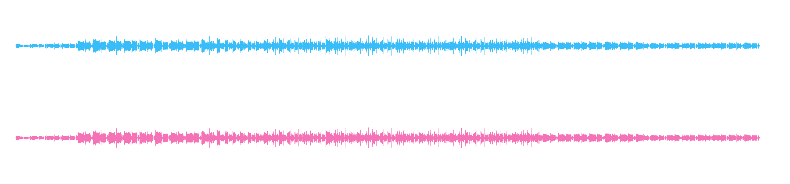

# From “Can It Sing?” to “What Should IA Sing in This Line?”

## Moving the VOCALOID MCP Beyond Engineering Closure into Intent, Music Theory, Reviewable Decisions, and Cold-Start Composition

- **Phase:** 2026-07-18 to 2026-07-19
- **Previous article:** [From a Blank Timeline to a Finished VOCALOID Song](from-blank-timeline-to-finished-vocaloid-song.md)
- **Primary voicebanks:** IA and IA_ROCKS
- **Phase-two change set:** 31 local commits, 125 changed files, and four complete creative-record packages
- **Final automated verification:** 102 tests discovered, 100 passed, 2 intentionally skipped, 0 failed
- **Final listening result:** the engineering workflow held; in the latest high-BPM test, the accompaniment masked IA and the track still did not feel convincingly like rock

---

## Abstract

Phase one answered a difficult question:

> Can an agent begin with a blank timeline, create a native VSQX, make the real VOCALOID3 Editor sing it with the requested voicebank, and then complete accompaniment, stems, mixing, mastering, QC, and delivery?

Yes.

Once that engineering loop closed, however, a harder and much more interesting question appeared:

> Stop asking, “Can it sing?” and begin asking, “What, exactly, do I want IA to sing out in this line?”

Phase two followed that question.

We added composition intent, phrase direction, a deterministic music-theory analyzer, bounded repair proposals, fingerprint-bound exceptions, a 20–30 second audition ladder, a creative decision journal, native tuning materialization, a phrase-grammar DSL, voicebank identity probes, a fixed intent-file prompt, and genuine fresh-agent cold-start composition tests.

We also deliberately declined an apparently attractive design: turning hundreds of local IA songs into a retrieval system that answers what the next note should be. The corpus was restricted to an offline, human-reviewed, non-reconstructive source of DSL vocabulary. A production agent cannot see track names, melodies, nearest neighbors, per-track features, or continuation hints.

In the resulting workflow, a fresh agent can start from a standalone intent file and carry out:

```text
intent
  -> theory / form / harmony
  -> melody
  -> Japanese note allocation
  -> IA delivery
  -> arrangement
  -> original Editor render
  -> mix / master / QC
  -> creative record
```

Yet the final 190 BPM IA_ROCKS experiment also gave us the most important counterexample. Every readiness gate passed. The VSQX contained 287 notes and 42 native controls. The WAV was unclipped, its loudness was in range, and every artifact hash was current. Human listening still found two fundamental problems:

1. the accompaniment buried IA;
2. the music remained flat and did not truly feel like rock.

The most honest conclusion of this phase is therefore:

> An agent can already be a very capable composer assistant, production engineer, and experimental partner. But the “masterpiece button” has not been engineered.

That is not failure. It means the system can finally distinguish engineering success from musical success.

## 1. What phase one left us

The previous article completed a concrete native production pipeline:

```text
empty manifest
  -> canonical score state
  -> VSQ3 / VSQ4 compiler
  -> XSD + Yamaha native-loader validation
  -> original VOCALOID3 Editor render
  -> isolated vocal/instrument stems
  -> deterministic mix graph
  -> loudness / peak / clipping analysis
  -> mastered WAV + matching VSQX
```

It solved the boundary between a 32-bit Windows legacy application and WSL/Node.js; native notes, lyrics, phonemes, note styles, vibrato, and master curves; Editor export automation; exact voice selection with fail-closed substitution; revisioned multi-track manifests and three hashes; accompaniment, stems, effects, automation, mixing, mastering, provenance, history, dry-run, and delivery currentness.

In other words, the system knew how to finish a song. It did not yet know why a song should be made that way.

Without another creative layer, an agent could easily produce a melody within range, schema-valid chords and phonemes, a non-silent WAV, and immaculate LUFS, true-peak, and balance metrics—while every line still sounded as though it were completing a checklist. The more reliable the engineering loop became, the more visible this problem was.

## 2. Intent before notes

Phase two adopted a lexicographic contract:

1. preserve the user's brief, lyrical meaning, and song/section/phrase intent;
2. make melody, harmony, rhythm, note allocation, IA delivery, and arrangement traceably serve that intent;
3. maintain internal consistency across form, timeline, harmony, singability, voice leading, and arrangement;
4. select phrase-grammar vocabulary when useful so grammatical roles and variation are explicit;
5. preserve authorship, artifact provenance, and uncertainty.

The order matters. If theory comes before intent, the agent smooths away every meaningful tension. If “IA style” comes first, the corpus or DSL gradually becomes a template. If audio metrics come before listening, the system mistakes -16 LUFS for sounding good.

The control flow became:

```text
user brief
    |
    v
song intent
    |
    +-- section transition
    |
    +-- 1–3 anchor phrase directions
             |
             v
      realization hypothesis
             |
             v
    theory / grammar / composition
             |
             v
       bounded audio audition
             |
             v
    keep / reject / revise by listening
```

## 3. Composition intent is not an emotion tag

The new `vocaloid-composition-intent/v1` contract has three levels:

| Level | What it preserves | What it does not preserve |
| --- | --- | --- |
| Song | premise, point of view, central tension, starting state, destination | recipes such as “sad = minor” |
| Section | dramatic function and the state before, through, and after a transition | automatic chords or melody |
| Phrase direction | utterance purpose, semantic focus, delivery arc, listening question | prose for every note |

A phrase direction can exist before any note, lyric unit, tuning gesture, or arrangement track. This permits the right sequence:

```text
First: “What must become audible in this line?”
Then: “What melody, duration, harmony, and delivery can realize it?”
Finally: bind the resulting stable IDs back to intent.
```

That is fundamentally different from generating a melody first and inventing a rationale afterward.

### 3.1 Why `intent_hash` is not `composition_hash`

Intent belongs to `content_hash`, but not to `composition_hash` or `mix_hash`, because two questions must remain separate:

1. Does this WAV still correspond to the current score?
2. Does this WAV still answer the current artistic question?

Changing intent should not force byte-identical audio to rebuild, but an earlier intent-fidelity listening review must become stale. That is the job of `intent_hash`.

### 3.2 Programs can measure realization, not emotional success

Structured targets describe measurable things: melodic contour and range, onset or duration trajectories, harmonic tension, DYN arches and valleys, arrangement density, and the duration or beat placement of a semantic focus.

They cannot turn prose emotion into pseudoscience. “Empty, distant, transparent” is not a fixed interval table. “Tighten the grip on the sword hilt” is not `DYN=94`.

## 4. Deterministic theory as a guardrail, not a substitute composer

The `core/v1` symbolic analyzer builds one read-only index, then evaluates form, timeline/meter/tempo, key/harmony, melody, rhythm, vocal allocation, voice leading, arrangement, and performance suitability.

It can locate timeline contradictions, chord-coverage gaps, unresolved sustained non-chord tones, unbalanced leaps, missing breath windows, mora and consonant timing budgets, unsuitable melisma phonemes, compound-meter conflicts, vocal minor seconds, crossings, slash-bass conflicts, register crowding, duplicated accompaniment roles, and density/energy mismatches.

It has no `SOUNDS_GOOD` rule code.

### 4.1 Severity has to be honest

| Severity | Meaning | Behavior |
| --- | --- | --- |
| `error` | contradictory or uninterpretable symbolic state | blocks score/build and cannot be excepted |
| `warning` | concrete musical or performance risk | may be auditioned; release policy may require disposition |
| `info` | composition or style observation | does not block build or delivery |

One registry owns every rule code, version, domain, permitted severity, and structural status. An analyzer cannot invent a code on the fly or disguise a style preference as a structural error.

### 4.2 The 20,000-event stress test was not a stunt

In a long song, quadratic scanning can be more dangerous than a wrong judgment because preflight simply stalls. Interval queries, register occupancy, and cross-track sweeps therefore use bounded indices. The 20,000-event fixture must complete within two seconds on the development host and must not mutate the input manifest.

### 4.3 Dry-run must execute the real path

Theory repair cannot use a simplified predictor while build uses different rules. `vocaloid_edit_song` dry-run executes the real mutation path on a copy, produces the predicted manifest, compares theory issues and intent evidence before and after, reports stale listening reviews, and leaves the canonical file untouched. A bounded proposal remains a hypothesis, not a hidden edit.

## 5. Repair proposals and exceptions cannot seize authorship

A theory proposal may offer at most three bounded alternatives. Each is bound to the current revision, composition hash, source issue code and exact fingerprint, affected stable IDs, predicted delta, and original phrase listening question.

The agent must run the proposal through the real dry-run, inspect introduced and resolved issues, and audition it before writing.

An exception is not an “ignore warning” button. It binds an exact object set and issue fingerprint. If a note, chord, section, or rule observation changes, the exception becomes stale and creates a structural error.

This preserves two things that initially look contradictory: an agent should not damage the music merely to pass tests, and it should not permanently suppress real risks with free-form prose.

## 6. The 20–30 second anchor audition

Full-song renders make feedback slow and obscure causality. The first creative closure is therefore a 20–30 second anchor rendered as:

1. IA lead solo;
2. lead plus harmony;
3. bass, drums, and one harmonic instrument;
4. optional full layers;
5. timbre/mix refinement;
6. a one-variable, loudness-matched A/B.

Every layer answers the same listening question. For the swordsmen song, that question was:

> Does “tighten the grip on the hilt” expose one instant of mutual alertness without becoming a theatrical duel?

If the lead solo does not carry it, adding strings, reverb, or limiting will not rescue it. If the solo works and the full mix fails, the search can move specifically toward arrangement and mixing.

## 7. The creative journal: reviewable decisions, not synthetic mind reading

The canonical manifest says what the song currently is. The journal says why this version was selected and what should be heard next.

Every delivered composition covers:

```text
intent
  -> form / meter-tempo / harmony / melody
  -> Japanese note allocation
  -> IA delivery
  -> arrangement
```

Each bounded decision records its objective, selected decision, concise rationale, alternatives and disposition, expected audible result, actual result when known, affected stable IDs/artifacts/hash dependencies, evidence, and next listening step.

The journal is an append-only SHA-256 chain. Later mutations do not delete past decisions; bindings to objects, artifacts, and hashes resolve them as current, stale, or superseded. It deliberately does not preserve hidden chain-of-thought. A public repository needs auditable reasons and evidence, not a model's private token stream masquerading as a creative artifact.

This phase produced 71 hash-chained decisions across four packages:

| Work | Revision | Decisions | Voice | Status |
| --- | ---: | ---: | --- | --- |
| `朝がほどく前に` | 41 | 11 | IA_ROCKS | 28-second intent-first demo |
| `遠い灯、青い夜` | 52 | 13 | IA_ROCKS | 2:10 cold-start song |
| `風は名を呼ばない` | 88 | 23 | original IA | 3:10 fresh-agent song |
| `雨と蝉のあいだ` | 78 | 24 | IA_ROCKS | 64-second, 190 BPM stability test |

The complete packages live in [`artifacts/creative-records/`](../artifacts/creative-records/README.md).

## 8. Declaring tuning does not mean the VSQX contains tuning

One valuable inspection found a manifest that declared a dynamics arc, opening arc, focus vibrato, and final pitch fall, while its published VSQX contained no corresponding `mCtrl`, PIT/PBS, or non-zero vibrato.

That exposed four distinct evidence levels:

```text
declared != materialized != rendered != heard
```

- `declared`: the gesture exists in canonical intent;
- `materialized`: the compiler emitted native note styles or controls;
- `rendered`: the original Editor produced a non-silent digest-bound stem;
- `heard`: a person or agent answered one explicit listening question.

The `apply_tuning` compiler became a required build-time materialization step. A declared but uncompiled gesture now triggers `TUNING_GESTURE_NOT_MATERIALIZED` and blocks build.

The interesting part is that the earlier track already worked better than its predecessors without decorative curves. Its feeling came primarily from lyrics, melodic contour, mora duration, selective harmony, silence, and restrained arrangement—from composition itself.

## 9. The local IA corpus became an offline vocabulary source

The original plan was ambitious: inventory the IA library, deduplicate works and versions, estimate audio, rhythm, harmony, form, and vocal-performance features, construct aggregate profiles, and run novelty audits. A read-only inventory found hundreds of audio files, including a baseline of 424 FLACs polluted by archives, off-vocals, remixes, duets, and duplicate encodes.

The deeper question was unavoidable:

> Are we expanding the agent's compositional choices, or moving it closer to reference reconstruction?

If the production agent can query a track's melodic contour, nearest neighbor, next note, producer range, per-track features, chord timeline, or long F0 sequence, an “aggregate” interface can quietly become a copying surface.

We retired production aggregate comparison entirely.

### 9.1 The firewall

A production agent cannot see corpus paths, source titles/producers/work IDs, per-track features, nearest examples, reference melody/chords/lyrics, continuation tables, or post-composition percentile fit.

The library's only remaining role is offline: when a maintainer observes that the DSL lacks a broadly useful phrase choice, that choice may be abstracted into general musical vocabulary, reviewed by a human, and versioned. Production sees only:

```text
role / entry / contour / rhythm / motion / cadence /
development / allocation / articulation / space
```

It cannot see which song inspired a term.

## 10. Phrase grammar: style choices, not template melodies

`vocaloid-phrase-grammar/v1` sits between intent and concrete notes:

```text
phrase purpose
  -> grammar blueprint
  -> agent-authored notes / rests / allocation
  -> IA delivery
  -> listening
```

Its dimensions cover roles such as statement, answer, contrast, lift, release, and hook; entry positions; arches, valleys, terraces, late peaks, and asymmetric waves; rhythmic contrast, ties, sparse breath, and compound lilt; stepwise motion, repeated tones, leap recovery, chord outlines, and modal pivots; open, closed, suspended, deceptive, plagal, and breath-cut cadences; development operations; lyric allocation; articulation; and space.

Bundles such as `ia.transparent-longline`, `ia.rocks-forward`, and `night.sparse-distance` are unordered option pools. Every bundle declares:

```text
melody_material = absent
```

The DSL contains no pitch sequence, scale-degree sequence, onset/duration sequence, melody compiler, or continuation table. The agent still writes the final notes from current intent, lyric prosody, harmony, and form.

## 11. One screenshot made the problem impossible to ignore

When `遠い灯、青い夜` opened in the editor, its melody visibly repeated:

```text
rise -> fall -> rise -> fall -> once again
```


Measurements supported the impression:

- all 20 lead phrases entered at the same beat position;
- 97.9% of comparable motion was a one-to-three-semitone step;
- core theory had already reported 77.9% repeated interval trigrams;
- 13 of 20 phrases placed their highest note in the late third;
- the largest normalized contour cluster contained 9 of 20 phrases.

We did not let the analyzer randomize notes. It reported only `PHRASE_ENTRY_HOMOGENEITY`, `PHRASE_MOTION_OVERCONCENTRATED`, and `PHRASE_PEAK_POSITION_CONCENTRATED`, then asked the agent to preserve phrase intent, propose a bounded alternative, and audition it.

That is the DSL's real purpose: help an agent notice that it keeps using the same grammar, without replacing it with another template.

## 12. Mastering A/B: do not let louder impersonate better

Another listening report described a sharp, separated, almost noisy texture in IA on `遠い灯、青い夜`. Dry lead and lead-plus-harmony anchors were clean, disproving the initial theory that IA_ROCKS itself was the problem.

Layer ablation measured:

| Layer | LUFS | LRA | True peak |
| --- | ---: | ---: | ---: |
| processed vocal only | -33.4 | 7.2 | -17.6 dBFS |
| minimal band | -33.4 | 7.2 | -17.6 dBFS |
| full premaster | -33.4 | 7.2 | -17.6 dBFS |
| final delivery | -15.5 | 5.8 | -1.5 dBFS |

Spectral-band ratios were nearly unchanged, but the final delivery was about 18 dB louder and had lower LRA. We created an equal-loudness A/B instead of globally changing IA, EQ, note gates, or arrangement.

The listener found slightly more of the texture in mastering B, noticeable mainly under direct comparison, with the overall result still acceptable. The decision was to keep the current delivery and avoid a global overfit.

The framework gained only transparency metrics: requested loudness gain, peak-safe gain, peak reduction needed to reach target, source/output LRA delta, and a transparency-review recommendation. This was a practical example of fixing a local diagnostic gap without moving the problem somewhere else.

## 13. Voicebank investigation: files on disk are not proof that the Editor can sing

The local VVD scanner listed IA and IA_ROCKS while the Editor initially showed only IA_ROCKS. The investigation separated file discovery, presence of a 32-bit VOICE3 registration marker, and an actual isolated render through the original Editor.

IA's activation-time marker initially contained zeroes. After legitimate registration state changed, IA appeared in the Editor. The repository never copied tokens, called an activation crack, or bypassed licensing.

An older readiness cache had marked both IA and IA_ROCKS verified even though their probe WAVs had identical SHA-256 digests. Non-silent audio proves that something sang, not that the requested singer sang. The new identity guard rejects exact cross-component digest collisions on the same host. Both banks eventually passed original-Editor probes with distinct digests.

## 14. Fresh-agent test one: `風は名を呼ばない`

To test transfer, a completely fresh `gpt-5.6-sol` session at `xhigh` received only this intent:

> Two swordsmen, separated for decades, meet again on a cliff and pass shoulder to shoulder. No greeting, no pause. Each tightens a hand around the sword at the waist, then forgets the other in the rivers and lakes.

It could not read the local IA corpus, previous song manifests or artifacts, earlier cold-start output, or existing compose scripts.

It completed `風は名を呼ばない` with original IA, a duration of 3:09.943, 68 measures, 12 tempo events, one 2/4 subtraction, 36 vocal phrases, 433 vocal events, five arrangement tracks, and 23 hash-chained decisions.

Its central creative choice was that IA represented neither swordsman, but the nameless mountain wind. The largest melodic departure belonged to `柄を握り`, and the passage after the crossing omitted an expected half-bar.

This showed that a new agent could internalize:

```text
intent -> theory -> note allocation -> IA delivery -> arrangement
```

It also wrote roughly 164 KiB of bespoke runner code and exposed short MCP timeouts, dead Editor leases, intermittent Save As filename failure, insufficiently idempotent journal retries, phrase-entry analysis that ignored leading rests, intent trends unable to express a local crest, excessive warning volume, awkward report reruns, and large raw-stem gain differences. These were not paper-design problems; a three-minute real song found them.

## 15. Turning one success into a reusable session

We extracted song-specific orchestration into:

- a fixed agent prompt: [`prompts/vocaloid-composition-agent.md`](../prompts/vocaloid-composition-agent.md);
- a strict `vocaloid-composition-brief/v1` schema;
- one `intents/*.intent.json` file per song;
- the MCP prompt `vocaloid_compose_from_intent`;
- the `npm run compose:prompt` renderer;
- the shared `scripts/lib/production-mcp.mjs` client.

An intent file explicitly retains scene, emotional color, dramatic motion, perspective, one listener question, duration range, BPM minimum/maximum/preference, exact voice component, genre/style tags, arrangement hints, must-avoid constraints, corpus/prior-artifact/reference boundaries, fresh-session rules, and issue-recording requirements.

Creative content no longer leaks into the workflow prompt. A new song changes only the intent file while the agent follows the same safety, evidence, and audition contract.

## 16. Fresh-agent test two: `雨と蝉のあいだ` at 190 BPM

The final transfer test used:

```json
{
  "intent": "summer night, rain, cicadas",
  "voice": "IA_ROCKS",
  "genre": "rock",
  "tempo_bpm": { "min": 180, "max": 200, "preferred": 190 },
  "target_duration_seconds": { "min": 50, "max": 70 }
}
```

A new `gpt-5.6-sol`/`xhigh` session received only the fixed prompt and validated intent. It delivered:

- `雨と蝉のあいだ`;
- 190 BPM, 48 bars, and 64.399683 seconds;
- a D Dorian/minor field;
- 241 IA_ROCKS lead notes and 46 harmony notes;
- five accompaniment roles and 24 creative decisions;
- schema-valid VSQ3;
- 18 DYN, 15 BRI, 4 PIT, 2 PBS, and 3 CLE controls;
- three notes with non-zero native vibrato;
- -16.3 LUFS, -1.2 dBTP, and zero clipped samples.


### 16.1 High BPM did not break the pipeline

The intent schema requires preferred BPM to fall inside the requested range. The agent selected 190 and used density changes plus half-time perception rather than turning the entire song into a subdivision flood. Editor export, stem alignment, mixing, mastering, creative-package publication, and final current-artifact preflight all completed. As a stability test, it succeeded.

### 16.2 A fresh session still guesses response shapes

Run code threw twice after successful canonical mutations because it guessed `preview.diff.totalChanges` and `predicted_revision`. The fix was not to paste those fields into the prompt. The shared client now normalizes one stable envelope containing source, predicted, and applied revisions, total changes, and all three hashes; it rejects revision drift, change-count drift, and missing integer fields.

### 16.3 D Dorian was mistaken for a major leading tone

The analyzer treated every D-Dorian C natural as an unresolved leading tone, producing 17 false warnings because it unconditionally called scale degree seven “the leading tone.” It now first checks whether that pitch is actually one semitone below tonic. Whole-tone subtonics in Dorian, Mixolydian, and Aeolian do not inherit major-key resolution duty. The 17 warnings disappeared without changing the song.

### 16.4 Whole-track means inverted sparse harmony roles

A low lead verse pulled down the lead's whole-song mean while harmony existed only in the chorus. Whole-track ordering therefore inverted the simultaneous upper/lower relationship and produced 46 crossings. The fix uses overlap-duration-weighted means from material that actually sounds together. Regression fixtures also had to become honest: a crossing test now contains a real simultaneous crossing rather than unrelated notes in different sections.

### 16.5 The F0 tracker selected the second harmonic

Five MIDI-67 windows were reported around +1,166 to +1,197 cents. Native note numbers and within-event/neighbor evidence pointed to 392 Hz, while the tracker selected approximately 768–783 Hz. We did not blindly fold every octave-like estimate toward the expected note because that would hide genuinely octave-wrong renders. The limitation remains open for subharmonic spectral support, periodic confidence, and temporal-continuity analysis.

## 17. Real WAVs can show many things, but not whether the rock works

The final stereo waveform:



The log-frequency spectrogram:


These images help reveal section density, channel activity, transient repetition, broad spectral occupation, and the post-mastering envelope. They cannot directly tell us whether IA owns the foreground, the guitar has physical attack, the drums propel the song, the chorus opens up, the result feels like rock, or one line reaches the listener. A spectrogram is not a genre oracle, and LUFS is not an emotion meter.

## 18. The final human feedback: the two most important red marks

After every technical gate passed, the listener's final response to `雨と蝉のあいだ` was:

1. IA was buried by the accompaniment;
2. the track remained relatively flat and did not capture a convincing rock feeling.

Per the request, we stopped without revising the song. The result matters because it exposes the most important remaining gap.

### 18.1 A mastering pass cannot guarantee vocal presence

A final WAV can satisfy loudness, true-peak, clipping, stereo-balance, and artifact-currentness policies while vocal masking remains. The present diagnostics are good at absolute loudness, peak, broad balance, and structural overlap. They cannot guarantee vocal presence, consonant intelligibility, midrange ownership, or section-by-section foreground hierarchy.

The right next step is not an automatic +6 dB vocal boost. Better observations include section-aware vocal-to-band loudness ratio, consonant-band masking, vocal-present versus vocal-muted deltas, declared arrangement slots, an explicit anchor question—“Is IA still in the foreground?”—and a human choice among gain, EQ, or subtracting arrangement layers.

### 18.2 “190 BPM + guitar + drums” does not equal rock

The DSL can offer `ia.rocks-forward`, syncopation, power-chord registers, drum drive, and half-time perception. Convincing rock often lives in much finer interaction: kick/bass/guitar microtiming, fills and handoffs, guitar articulation and amp behavior, bass push and pull beyond roots and fifths, a vocal phrase resisting the backbeat, physical contrast between verse and chorus, performance imperfection, and musician-like sound design.

The project's GM SoundFont is a deterministic draft backend. It validates arrangement events, routing, and the mix pipeline; it is not a band with physical feel. This is a shared renderer and composition limitation, not something a better prompt alone can repair.

## 19. What this phase actually proved

### 19.1 Proven

- Intent can be canonical state rather than a disposable prompt.
- A fresh agent can follow an intent-first workflow.
- Theory analysis can be deterministic, bounded, and non-mutating.
- Proposals can preserve a phrase's listening question instead of replacing its purpose.
- Warnings, exceptions, and listening gates can remain distinct.
- Japanese note allocation can be recorded completely.
- Tuning intent can materialize as native VSQX controls.
- Creative decisions can form a hash chain and resolve freshness across revisions.
- Phrase grammar can expand vocabulary without supplying template notes.
- The local IA corpus can remain outside production runtime.
- Real Editor renders with distinct digests can verify IA and IA_ROCKS identity.
- A fresh session can create an original song, VSQX, WAV, stems, A/B, and record.
- A strict 180–200 BPM intent can complete a stable 190 BPM delivery.
- Real songs reliably expose API, analyzer, retry, and UI-automation defects.

### 19.2 Not proven

- That agents consistently write good melodies.
- That phrase grammar guarantees variety or excitement.
- That theory cleanliness implies emotional success.
- That more native controls sound more natural.
- That LUFS, LRA, or spectral metrics decide whether a mix sounds good.
- That IA-style vocabulary produces an “IA masterpiece.”
- That GM accompaniment gives a credible rock performance.
- That quality transfers consistently across intents and fresh agents.
- That passing every gate makes a work release-worthy.

## 20. Why “the masterpiece has not been engineered” is healthy

The project would have failed if it concluded:

```text
intent schema + theory rules + phrase DSL + metrics = good song
```

That equation would compress taste, surprise, timing, performance, cultural context, and listener response into features that can be gamed.

The healthier division of labor is:

| Agents are good at | The framework is good at | Humans remain irreplaceable at |
| --- | --- | --- |
| proposing multiple realizations | preserving state and provenance | hearing “this simply is not right” |
| rapidly changing form, melody, and allocation | preventing corruption and stale artifacts | judging emotional and stylistic success |
| generating arrangement hypotheses | constructing bounded A/B tests | choosing what deserves to remain |
| recording rationale and alternatives | measuring, validating, and rerunning | deciding when to stop |
| learning workflows from real failures | turning failures into regressions | taking responsibility for the work |

The agent is already a useful composer assistant, production engineer, experiment operator, obsessive documentation partner, and teammate who will not complain about the seventeenth A/B. It is not a one-click hit machine.

## 21. What the repository keeps

The public repository does not track the enormous local audio workspace.

| Path | Git policy | Reason |
| --- | --- | --- |
| `artifacts/songs/` | local only | final WAVs are large and may involve release/licensing choices |
| `artifacts/evals/` | local only | stems, A/B audio, debug exports, and agent traces |
| `build/` | local only | canonical working state, cache, and temporary renders |
| `artifacts/creative-records/` | tracked | manifest snapshots, journals, reports, and digest indexes |
| `artifacts/vsqxs/` | tracked | native-project evidence, without voicebank data or final WAVs |
| `notes/` | tracked | contracts, failure logs, and evaluation evidence |
| `blogs/` | tracked | readable engineering and creative retrospectives |

VSQX retains a backing-path reference but does not embed the WAV. Creative-record indexes retain final-delivery digests but do not copy large media. The repository therefore preserves auditable creative and engineering evidence without turning 2.6 GB of local experiments into Git history.

---

## Conclusion

Phase one turned “blank timeline to native rendered song” into a reliable engineering pipeline.

Phase two moved the question upstream:

```text
Do not ask only: Can it sing?
Ask first: What should IA sing out in this line?
```

We built intent, theory, phrase grammar, note allocation, delivery, audition, journaling, and fresh-session transfer. An agent can now turn an ambiguous scene into a complete work that is inspectable, editable, renderable, and reviewable.

Then human ears can still say:

```text
IA is buried.
The rock feeling is not there.
```

And the system does not argue back with 100 passing tests.

That may be phase two's most important achievement. We did not merely teach an agent to finish songs; we taught the system to face the fact that a finished song is not necessarily a good song.

> This phase has proved that an agent can be a very capable composer assistant, production engineer, and experimental partner. But the “masterpiece button” has not been engineered.
