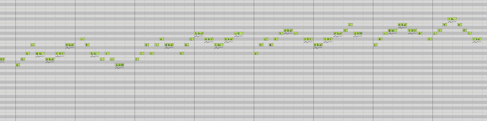
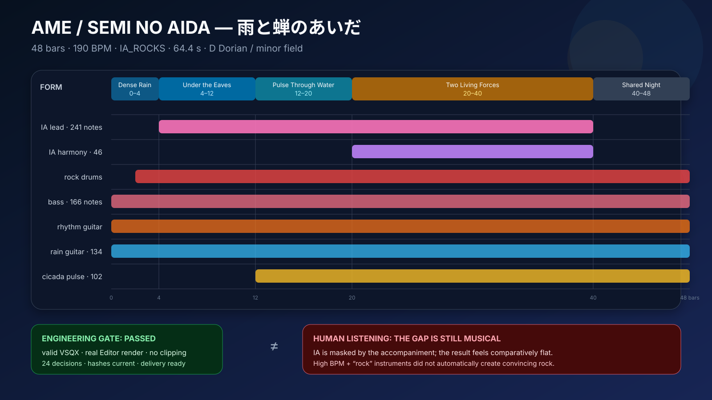
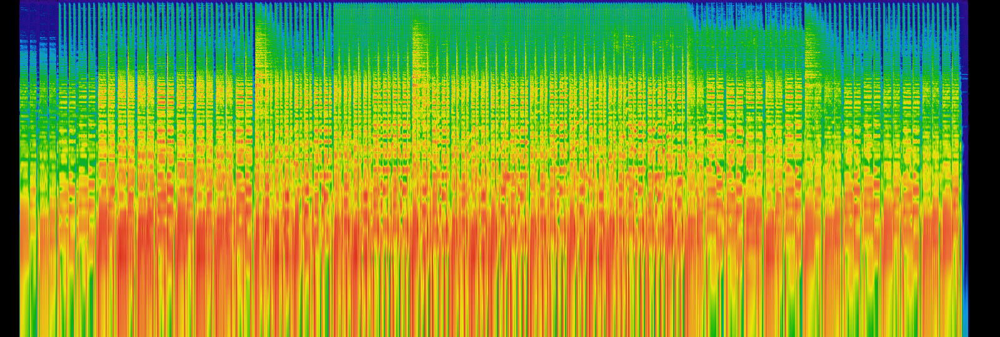

# From "Can It Sing?" to "What Should IA Sing in This Line?"

*How the VOCALOID MCP moved past engineering closure into intent, music theory, reviewable decisions, and cold-start composition.*

The [first article](from-blank-timeline-to-finished-vocaloid-song.md) answered a hard engineering question: can an agent start from a blank timeline, write a native VSQX, get the real VOCALOID3 Editor to sing it with the requested voicebank, and carry the result through accompaniment, stems, mixing, mastering, and delivery? It can.

Once that loop worked, a harder and much more interesting problem took its place. An agent could now produce a melody that stays in range, chords and phonemes that validate, a WAV that isn't silent, and loudness numbers a mastering engineer would sign off on, and every line could still sound like it was ticking a box. The more reliable the engineering became, the more obvious that gap was. The system knew *how* to finish a song. It had no idea *why* a song should go one way rather than another.

This article covers the second phase, which ran on July 18–19, 2026, and was organized around one question: not "can it sing?" but "what, exactly, do I want IA to sing out in this line?"

## Intent comes first, and the order matters

The phase adopted a strict priority order for every decision:

1. Preserve the brief, the lyric's meaning, and the stated song, section, and phrase intent.
2. Make melody, harmony, rhythm, note allocation, vocal delivery, and arrangement traceably serve that intent.
3. Keep form, timeline, harmony, singability, voice leading, and arrangement internally consistent.
4. Use phrase-grammar vocabulary where it helps make roles and variation explicit.
5. Keep authorship, provenance, and uncertainty visible.

The order is the point. Put theory before intent and the agent sands away every meaningful tension. Put "IA style" first and the style vocabulary quietly becomes a template. Put audio metrics before listening and the system starts believing that −16 LUFS means "sounds good".

## Intent is not an emotion tag

The `vocaloid-composition-intent/v1` contract works at three levels. At the **song** level it records the premise, point of view, central tension, starting state, and destination. At the **section** level it records what the section does dramatically and what changes across it. At the **phrase** level it covers one to three anchor phrases, each with a purpose, a semantic focus, a delivery arc, and exactly one listening question.

What the contract deliberately does *not* contain is recipes. There's no "sad means minor", no automatic chord or melody, no prose for every note. A phrase direction can exist before a single note does. The right order of operations is: decide what must become audible in this line, then find the melody, durations, harmony, and delivery that can make it audible, then bind the resulting stable IDs back to the intent. That is the opposite of writing a melody and inventing a rationale afterwards.

Intent gets its own hash, separate from the composition and mix hashes, because two questions have to stay apart: does this WAV still match the current score, and does it still answer the current artistic question? Changing the intent shouldn't force a byte-identical render to be rebuilt, but it should mark any earlier listening review of that intent as stale.

The contract can carry measurable targets: contour and range, onset and duration trends, harmonic tension, dynamics arcs, arrangement density, and how long the semantic focus is held. It refuses to turn emotion into pseudoscience. "Empty, distant, transparent" is not an interval table, and "tighten the grip on the sword hilt" is not `DYN=94`.

## Theory as a guardrail, not a ghostwriter

The `core/v1` analyzer builds one read-only index of the song and checks form, timeline, meter, tempo, key, harmony, melody, rhythm, vocal allocation, voice leading, arrangement, and performance. It can find timeline contradictions, gaps in chord coverage, unresolved sustained non-chord tones, unbalanced leaps, missing breaths, consonant timing that doesn't fit, melisma on vowels that won't carry it, vocal minor seconds and crossings, slash-bass conflicts, register crowding, duplicated accompaniment roles, and density that doesn't match the section's energy.

It has no rule called `SOUNDS_GOOD`.

Severity has to be honest:
- An **error** means the symbolic state is contradictory or can't be interpreted. It blocks the build, and no exception can override it.
- A **warning** is a concrete musical or performance risk. It can be auditioned and, if the release policy requires it, explicitly dispositioned.
- An **info** is an observation about style. It never blocks anything.

A single registry owns every rule code, its version, and its allowed severity, so no analyzer can invent a code on the fly or dress up a style preference as a structural error.

Two engineering details turned out to matter more than expected. First, performance: in a long song a quadratic scan is worse than a wrong judgment, because preflight simply never finishes. The analyzer uses interval indices throughout, and a 20,000-event fixture has to finish in under two seconds without touching its input. Second, dry runs: a repair can't be evaluated with a simplified predictor while the build uses different rules. `vocaloid_edit_song` with `dry_run` executes the real mutation on a copy, compares theory issues and intent evidence before and after, reports which listening reviews would go stale, and leaves the canonical file alone.

## Repairs and exceptions can't take over authorship

When the analyzer finds a problem it can offer up to three bounded alternatives. Each is tied to the current revision, the exact issue fingerprint, the affected stable IDs, a predicted delta, and the phrase's original listening question. The agent must still run the candidate through a real dry run, inspect what it fixes and what it introduces, and listen before writing anything.

An exception is not an "ignore warning" button. It binds an exact set of objects and an exact issue fingerprint. If the note, chord, section, or rule changes, the exception goes stale and becomes a structural error. That reconciles two goals that look like they conflict: an agent shouldn't damage the music just to make a check pass, and it shouldn't be able to silence a real risk forever with a sentence of prose.

## Test one passage before rendering a whole song

Full-song renders are slow and make it hard to tell what caused what. So the first creative milestone is a 20–30 second anchor passage, built up in layers: IA alone, then lead plus harmony, then bass, drums, and one harmonic instrument, and only then the fuller arrangement, timbre and mix refinements, and a single-variable A/B at matched loudness.

Every layer answers the same question. For the swordsmen song it was: *does "tighten the grip on the hilt" expose a single instant of mutual alertness without turning into a theatrical duel?* If the solo line doesn't carry that, no amount of strings, reverb, or limiting will rescue it. If the solo works and the full mix doesn't, you know to look at arrangement and mixing.

## A journal of decisions, not a transcript of thoughts

The manifest says what the song currently is. The creative journal says why this version won and what to listen for next. Every delivered song covers the same chain: intent, then form, meter and tempo, harmony, and melody, then Japanese note allocation, then IA delivery, then arrangement. Each decision records its objective, the choice, a short rationale, the alternatives and what happened to them, the expected audible effect, the actual result when known, the stable IDs and artifacts it binds to, and the next listening step.

The journal is an append-only SHA-256 chain. Later edits never delete earlier decisions; instead, each decision resolves as current, stale, or superseded depending on whether its bound objects, artifacts, and hashes still match. It does not store the model's hidden reasoning. A public repository needs auditable reasons and evidence, not a private token stream dressed up as a creative artifact.

The phase produced 71 decisions across four packages:

| Work | Decisions | Voice | What it was |
| --- | ---: | --- | --- |
| `朝がほどく前に` | 11 | IA_ROCKS | 28-second intent-first demo |
| `遠い灯、青い夜` | 13 | IA_ROCKS | 2:10 cold-start song |
| `風は名を呼ばない` | 23 | IA | 3:10 fresh-agent song |
| `雨と蝉のあいだ` | 24 | IA_ROCKS | 64-second, 190 BPM stability test |

All four live in [`artifacts/creative-records/`](../artifacts/creative-records/README.md).

## Declaring tuning is not the same as tuning

One inspection found a manifest that declared a dynamics arc, an opening arc, a focus vibrato, and a closing pitch fall, while the published VSQX had no matching controls, no PIT/PBS data, and no vibrato at all. That separated four kinds of evidence that had been blurring together:

- **declared**: the gesture exists in the canonical intent;
- **materialized**: the compiler wrote native note styles or control curves;
- **rendered**: the original Editor produced a non-silent, digest-bound stem;
- **heard**: a person (or an agent) answered one explicit listening question.

Materialization is now a required build step. A gesture that was declared but never compiled raises `TUNING_GESTURE_NOT_MATERIALIZED` and stops the build. And as the companion article notes, the song in question already worked better than its predecessors before any of those curves existed. Its feeling came from the lyrics, the melodic contour, the mora durations, selective harmony, silence, and a restrained arrangement. In other words, from composition.

## A firewall around the local IA library

The original plan was ambitious: inventory the local IA library, deduplicate works and versions, extract rhythm, harmony, form, and vocal features, and build aggregate style profiles. A read-only pass found a baseline of 424 FLAC files, padded out with archives, off-vocal versions, remixes, duets, and duplicate encodes.

Then the real question came up: are we widening the agent's choices, or moving it closer to reconstructing references? If a production agent can ask for a track's contour, its nearest neighbor, the likely next note, a producer's range, or a chord timeline, an "aggregate" interface quietly becomes a copying tool.

So production-time comparison against the library was removed entirely. A production agent cannot see corpus paths, titles, producers, per-track features, nearest examples, reference melodies, chords, or lyrics, continuation tables, or how well a finished song "fits" the library. The library's only remaining job is offline: when a maintainer notices the phrase vocabulary is missing a broadly useful choice, that choice can be abstracted into general musical terms, reviewed by a human, and versioned. Production sees only the vocabulary categories (role, entry, contour, rhythm, motion, cadence, development, allocation, articulation, space), never which song inspired a term.

## Phrase grammar: choices, not templates

`vocaloid-phrase-grammar/v1` sits between a phrase's purpose and its notes. It names roles (statement, answer, contrast, lift, release, hook), entry positions, contour shapes (arch, valley, terrace, late peak, asymmetric wave), rhythmic devices, kinds of motion (stepwise, repeated tone, leap and recovery, chord outline, modal pivot), cadence types, development operations, lyric allocation, articulation, and use of space.

Bundles such as `ia.transparent-longline`, `ia.rocks-forward`, and `night.sparse-distance` are unordered pools of options, and every bundle declares `melody_material = absent`. The grammar contains no pitch sequence, no scale-degree sequence, no rhythm sequence, no melody compiler, and no continuation table. The agent still writes every note from intent, prosody, harmony, and form.

The need for it became obvious the moment `遠い灯、青い夜` opened in the Editor:

The numbers backed up what the eye saw. All 20 lead phrases entered at the same beat position. 97.9% of comparable motion was a step of one to three semitones, 77.9% of interval trigrams repeated, 13 of 20 phrases peaked in their last third, and the biggest contour cluster held 9 of the 20 phrases. The analyzer was not allowed to randomize anything. It reported `PHRASE_ENTRY_HOMOGENEITY`, `PHRASE_MOTION_OVERCONCENTRATED`, and `PHRASE_PEAK_POSITION_CONCENTRATED`, and asked the agent to keep each phrase's intent, propose a bounded alternative, and audition it. That's the grammar's real purpose: help an agent notice it keeps using the same moves, without handing it a different set of moves to repeat.

## Don't let louder pass for better

A listener reported that IA sounded sharp and slightly noisy in the final `遠い灯、青い夜` delivery. The dry lead and lead-plus-harmony anchors were clean, so the voicebank wasn't the problem. Removing layers one by one showed that the processed vocal, the minimal band, and the full premaster all measured the same: −33.4 LUFS, 7.2 LU of loudness range, −17.6 dBFS true peak. The final delivery measured −15.5 LUFS, 5.8 LU, −1.5 dBFS. The spectral balance had barely moved. The delivery was about 18 dB louder and a little more compressed.

So instead of globally re-EQing IA, changing note gates, or thinning the arrangement, we made an equal-loudness A/B of the two masters. The listener heard slightly more of the texture in one of them, mostly under direct comparison, and found the overall result acceptable. We kept the delivery. The framework gained only the missing diagnostics: requested gain, peak-safe gain, the peak reduction needed to hit the target, the loudness-range change between source and output, and a flag recommending a transparency review. The local gap got fixed, and nothing else got overfitted along the way.

## Files on disk don't prove the Editor can sing

The voice scanner listed both IA and IA_ROCKS, but the Editor only showed IA_ROCKS. Investigating it meant separating three things: the voicebank files on disk, the presence of the 32-bit registration markers, and an actual isolated render. IA's activation marker was initially all zeros; once its legitimate registration state changed, IA appeared in the Editor. Nothing in the repository copies tokens, runs activation tools, or bypasses licensing.

The investigation also turned up something worse. An older readiness cache had marked *both* voices verified even though their probe WAVs had identical SHA-256 digests. Non-silent audio proves that something sang, not that the requested singer did. The probe now rejects an exact digest collision between two different voice components on the same host. Both voices eventually passed with distinct digests.

## Fresh agent, test one: `風は名を呼ばない`

To test whether the workflow transfers, a brand-new Codex session (gpt-5.6-sol at xhigh) got only this brief:

> Two swordsmen, parted for decades, meet again on a cliff and pass shoulder to shoulder. No greeting, no pause. Each tightens a hand around the sword at his waist, then forgets the other among the rivers and lakes.

It couldn't read the IA library, earlier manifests or artifacts, or any existing compose scripts. It delivered `風は名を呼ばない` for the original IA voice: 3:10, 68 measures, 12 tempo events, one subtracted 2/4 bar, 36 vocal phrases, 433 vocal events, five arrangement tracks, and 23 decisions. Its central choice was that IA is neither swordsman but the nameless mountain wind. The biggest melodic departure lands on `柄を握り` ("gripping the hilt"), and the passage right after the two men pass is missing an expected half-bar.

It also wrote about 164 KiB of one-off runner code, and in doing so found short MCP timeouts, dead Editor locks, intermittent Save As failures, journal retries that weren't idempotent, phrase-entry analysis that ignored leading rests, intent trends that couldn't express a local crest, too many warnings, awkward report reruns, and big gain differences between raw stems. A three-minute real song found problems no design review would have.

## Turning one success into a repeatable session

The song-specific orchestration was then pulled apart into reusable pieces:
- a fixed agent prompt, [`prompts/vocaloid-composition-agent.md`](../prompts/vocaloid-composition-agent.md);
- a strict `vocaloid-composition-brief/v1` schema, with one `intents/*.intent.json` per song;
- the `vocaloid_compose_from_intent` MCP prompt and the `npm run compose:prompt` renderer;
- a shared stdio client, `scripts/lib/production-mcp.mjs`.

An intent file holds the scene, emotional color, dramatic motion, point of view, one listener question, a duration range, a BPM range with an optional preferred value, the exact voice component, genre and style tags, arrangement hints, things to avoid, source boundaries, and fresh-session rules. The creative content stays out of the workflow prompt, so a new song changes one file while the safety, evidence, and audition rules stay the same.

## Fresh agent, test two: `雨と蝉のあいだ` at 190 BPM

The last test asked for "summer night, rain, cicadas", IA_ROCKS, rock, 180–200 BPM (preferring 190), and 50–70 seconds. A new session given only the prompt and the validated brief delivered `雨と蝉のあいだ`: 190 BPM, 48 bars, 64.4 seconds, a D Dorian/minor field, 241 lead notes and 46 harmony notes, five accompaniment roles, 24 decisions, and a schema-valid VSQ3. The VSQ3 carried 18 DYN, 15 BRI, 4 PIT, 2 PBS, and 3 CLE controls, plus three notes with native vibrato. The master measured −16.3 LUFS and −1.2 dBTP with zero clipped samples.

As a stability test it succeeded. The agent picked 190 BPM and used density changes and half-time feel instead of filling every subdivision, and the export, stem alignment, mix, master, record publication, and final preflight all completed. Four lessons came out of it:

- **Fresh sessions still guess response shapes.** The runner crashed twice *after* successful writes because it guessed field names. The fix was not to paste field names into the prompt. The shared client now returns one normalized envelope (source, predicted, and applied revisions, change counts, all three hashes) and rejects any drift.
- **D Dorian's C natural is not a leading tone.** The analyzer called every one of them an unresolved leading tone, which produced 17 false warnings, because it treated scale degree seven as a leading tone unconditionally. It now checks that the pitch really sits a semitone below the tonic. The warnings disappeared without touching the song.
- **Whole-track averages inverted sparse harmony.** A low verse pulled the lead's song-wide average down while the harmony only existed in the chorus, so the analyzer reported 46 crossings. Voice ordering now uses duration-weighted means over material that actually sounds together, and the regression test now contains a real crossing.
- **The pitch tracker sometimes picks the second harmonic.** Five windows on a 392 Hz note were read near 780 Hz. We didn't fold every octave-like estimate back toward the expected note, because that would hide renders that genuinely are an octave off. This one is still open.

## What the waveform can't tell you

These images show section density, channel activity, repeated transients, broad spectral occupancy, and the shape of the master. They can't tell you whether IA owns the foreground, whether the guitar has any physical attack, whether the drums push the song, whether the chorus opens up, or whether it feels like rock. A spectrogram is not a genre detector, and LUFS is not an emotion meter.

After every technical gate passed, the listener said two things: IA was buried by the accompaniment, and the track was flat and didn't feel like rock. We stopped there on purpose, without revising, because those two notes describe the most important open gaps.

**Vocal presence.** A master can meet every loudness, peak, clipping, balance, and currentness policy and still mask the singer. The current diagnostics are good at absolute loudness, peaks, and structural overlap, but they can't guarantee vocal presence, consonant intelligibility, or who owns the midrange in each section. The answer is not an automatic +6 dB on the vocal. Better measurements would be section-aware vocal-to-band ratios, consonant-band masking, the difference between vocal-on and vocal-muted renders, and an explicit anchor question ("is IA still in front?"), followed by a human choice between gain, EQ, or removing a layer.

**"Rock" is more than 190 BPM plus guitar plus drums.** The grammar can offer `ia.rocks-forward`, syncopation, power-chord registers, a driving kit, and half-time feel. Convincing rock lives somewhere finer: microtiming between kick, bass, and guitar, fills and handoffs, guitar articulation and amp behavior, a bass that pushes and pulls rather than sitting on roots and fifths, a vocal line that leans against the backbeat, real physical contrast between verse and chorus, and the small imperfections of people playing together. The General MIDI SoundFont renderer is a deterministic draft backend. It proves the arrangement, routing, and mix pipeline, but it isn't a band. No prompt can fix that alone.

## What this phase proved, and what it didn't

It proved that intent can be canonical state rather than a throwaway prompt. A fresh agent can follow an intent-first workflow. Theory analysis can be deterministic, bounded, and non-mutating, and repair proposals can keep a phrase's question instead of replacing its purpose. Warnings, exceptions, and listening gates can stay distinct. Japanese note allocation can be recorded completely, tuning intent can be materialized into native controls, and creative decisions can form a hash chain that tracks freshness across revisions. A phrase vocabulary can grow without supplying notes, and the local library can stay out of production entirely. Distinct-digest renders can verify voice identity. A new session can write an original song with a VSQX, stems, an A/B, and a full record, and a strict high-BPM brief can complete as a stable delivery. And real songs reliably expose bugs in APIs, analyzers, retries, and UI automation.

It did not prove that agents consistently write good melodies. It didn't prove that the grammar guarantees variety, that clean theory means emotional success, that more native controls sound more natural, that loudness or spectral metrics can judge a mix, that IA-flavored vocabulary produces an IA masterpiece, that General MIDI makes credible rock, that quality transfers reliably across briefs and sessions, or that passing every gate makes a song worth releasing.

## Why "the masterpiece hasn't been engineered" is a healthy result

The project would have failed if it had concluded that an intent schema, theory rules, a phrase DSL, and metrics add up to a good song. That equation squashes taste, surprise, timing, performance, cultural context, and the listener's response into features that can be gamed.

A better division of labor emerged instead. The agent is good at proposing several realizations, quickly changing form, melody, and allocation, generating arrangement ideas, writing down its reasons, and learning the workflow from real failures. The framework is good at keeping state and provenance straight, preventing corruption and stale artifacts, building bounded A/B tests, measuring and re-running, and turning failures into regression tests. The human remains irreplaceable at hearing that something just isn't right, judging whether it works emotionally and stylistically, choosing what stays, deciding when to stop, and taking responsibility for the result.

Phase one turned "blank timeline to rendered song" into a reliable pipeline. Phase two moved the question upstream. The agent can now turn a vague scene into a complete piece that is inspectable, editable, renderable, and reviewable, and when a person listens and says "IA is buried, and it doesn't rock", the system doesn't argue back with a hundred passing tests. That may be the most important thing this phase built: a system that can tell the difference between a finished song and a good one.
