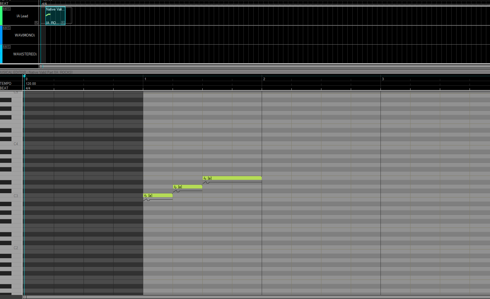

# We Told a Coding Agent to Make VOCALOID Songs. It Got Out of Hand.

*IDA, Win32 dialogs, Japanese morae, swordsmen, rain, cicadas, and a 190 BPM song that still doesn't rock.*

It started as a joke with a real question inside it. We had VOCALOID3, the IA and IA_ROCKS voicebanks, a coding agent running in WSL, and a free weekend. Could the agent make a Vocaloid song by itself?

If "make a song" had meant "export a MIDI file", we would have been done by lunch. We wanted more than that: a native VSQX project, Japanese lyrics with real phonemes, IA's actual voice rendered by the actual VOCALOID3 Editor, accompaniment, stems, a mix, a master, and a project file that still opened afterwards. And because we are the kind of people who build things like this for fun, we also wanted a record of *why* each line was sung the way it was.

Two days later we had a TypeScript MCP server, a 32-bit Windows helper, a UI-automation state machine, a canonical song database, a music-theory analyzer, a Japanese mora allocator, an audio production graph, a hash-chained decision journal, and an unreasonable number of Save As dialogs. We also had finished songs.

We had a more interesting answer too. Engineering can get an agent to *finish* a song. It cannot yet get it to write a great one.

## Rule one: no MIDI, no templates

A Vocaloid performance is a lot more than pitch and duration. Each note carries a lyric, a phoneme string, consonant timing, accent, decay, mouth opening, bends, portamento, and a vibrato envelope. Around the notes sit continuous curves for dynamics, breathiness, brightness, and pitch, plus parts, pre-measures, mixer state, and the singer binding. MIDI throws most of that away.

So the first rule was simple: the agent builds a native project from nothing. No copying a known-good VSQX, swapping a few notes, and calling it composition.

The first success looked like this:



Three notes, a valid IA_ROCKS singer, and an Editor that agreed to open the file. Getting there meant reading the VOCALOID3 manual, studying the VSQ3/VSQ4 schemas, opening 32-bit DLLs in IDA, writing a probe that loads projects through Yamaha's own `Vsq3.dll`, and spending half a day convinced that the phoneme `4 a` was our bug. It wasn't. In VOCALOID's Japanese phoneme set, `4` is the flap in ら. The manual had been saying so the whole time.

## We almost called the synthesis engine directly

IDA showed a tempting route: load the VSQX, encode a musical part into the engine's internal "Daisy" event stream, hand it to the DSE3 synthesizer, and collect 256-sample frames into a WAV. No Editor, no UI, just a function call.

We got surprisingly far. The probe loaded the project, built the time map, encoded the events, loaded both DLLs, and resolved every export we needed. Then the engine returned `-100` at the voice-database step. That step reads registry state tied to voicebank installation and activation.

At that point we had two options: dig into licensing internals, or move up a level and let the original Editor do the synthesis, since it already has a legitimate, fully registered context. We moved up. It felt like giving up at the time. In hindsight it was the most useful result of the reverse-engineering work: we knew exactly where the line was, and why the production design had to sit above it.

## The final boss is a desktop app from 2014

The VOCALOID3 Editor is not an API. It opens modal dialogs, wants a filename typed into a Save As box, sometimes remembers its last folder and sometimes doesn't, keeps running after it looks closed, and now and then crashes during cleanup.


Driving it reliably meant treating every export as a transaction. Fingerprint the Editor binary. Take a host-wide lock. Launch the exact project on a hidden desktop. Check the singer. Trigger Export Wave. Wait for a *fresh* Save dialog, fill it in, submit, and wait with a progress-aware timeout. Then check that the output is a well-formed, non-silent WAV with a recorded digest. Close only the process we launched, and release the lock.

"A file appeared" never counts as success. Partial exports, zero-byte files, silence, a quietly substituted default singer, and stale dialog handles all have to fail loudly. None of these bugs had anything to do with music, but any one of them could leave a finished song stuck inside the Editor. (Months later the Editor found a new trick. A pair of unplugged headphones left its saved audio device pointing at nothing, and it refused to export until someone clicked OK in a dialog nobody could see. The helper now tells you that, too.)

## An XML writer turns into a small production system

VSQX is a good file to hand to the Editor and a poor place to keep everything else. It has nowhere to put effect chains, artifact hashes, review notes, dependencies, edit history, or the question an A/B test is supposed to answer.

So a JSON manifest, `.song.json`, became the source of truth. Every edit carries a revision number and stable IDs, and three hashes are recomputed each time: one for content, one for composition, one for mix. Writes are atomic and backed up. The VSQX, backing track, stems, mixes, and masters are all derived from the manifest.

That sounds like the opposite of fun, but it makes the fun part possible. The agent can rewrite one chorus line without resending three thousand events, and an old WAV can never pass itself off as the current song.

## The first finished songs

The pipeline closed on three IA_ROCKS songs in three styles:

| Song | Style | Length |
| --- | --- | ---: |
| `花色日和` | wa-rock | 4:16 |
| `火花の航路` | driving J-rock | 2:07 |
| `夏の夜に浮かぶ声` | summer-night dream pop | 3:18 |

Each had a lead and a harmony line, several instruments, isolated stems, a mix, a master that passed loudness, peak, and clipping checks, and a matching VSQX. The pipeline could deliver a complete song.

So we asked the uncomfortable question: what is it actually trying to *say*?

## The engineer steps back, the composer steps in

The second phase was built around one question: not "can it sing?" but "what do I want IA to sing out in *this* line?"

The repository grew a vocabulary for that. Composition intent comes first: what the song is about, what each section changes, and which one to three anchor phrases carry the weight, each with a single listening question. A deterministic theory analyzer flags real risks such as voice crossings, missing breaths, register crowding, and unresolved tones. It is explicitly not allowed to decide that a line is moving. A short audition ladder (solo, then with harmony, then with a minimal band) tests one anchor passage before anyone renders a whole song. And a creative journal records each decision, the alternatives it beat, and what the listener should expect to hear.

Evidence came in four levels: *declared*, *materialized*, *rendered*, *heard*. They matter because an audit soon found a manifest that declared a dynamics arc, an opening arc, a focus vibrato, and a final pitch fall, while the VSQX it produced contained none of them. That's like writing "the singer trembles on the last line" in the session notes and then forgetting to record it. Now a declared gesture that never made it into native controls blocks the build.

The funny part: that song already sounded better than the earlier ones before any of those curves existed. The lyrics, the contour, the timing of the morae, a little harmony, and some silence were doing the real work. Automation can't stand in for composition.

## Hundreds of IA songs the agent is not allowed to see

The machine has a few hundred IA tracks on disk. The obvious idea was to profile all of them (tempo, form, harmony, pitch contours) and let the agent consult the profile while composing.

It doesn't take long to see where that ends up. If the agent can ask for the nearest melody or the next likely note, a "style system" turns into an imitation system. So we made a rule that looks restrictive and turned out to be freeing: the production agent cannot see the library at all. The only thing the library may do is help a human maintainer notice that the phrase vocabulary is missing a generally useful idea. That idea then gets added in abstract form, with no source identity and no notes.

The agent gets words like *delayed entry*, *late peak*, *semantic breath*, and *modal pivot*. It never gets "do what happens at 0:27 in that song".

## Melodies really do turn into staircases

After a fresh agent wrote `遠い灯、青い夜`, we opened the VSQX and saw this:


Rise, fall, rise, fall. Every phrase entered on the same beat, and 97.9% of the melodic motion was small steps. It wasn't random. It was painfully tidy.

That screenshot is where the phrase grammar came from, along with a hard rule against letting it generate melody. Fixing "the agent is too formulaic" by handing it more formulas would just give it a bigger template library. The grammar asks better questions instead: is this line a statement or an answer? Does it enter on the downbeat, as a pickup, or late? Is it an arch, a terrace, a plateau? Where does the breath go? Is the development repetition or fragmentation? The notes still come from the agent.

## Can a brand-new agent take over?

To find out, we started a fresh Codex session (gpt-5.6-sol, xhigh reasoning) with no access to the library, the earlier songs, or the old composition scripts, and gave it one image: two swordsmen who haven't seen each other in decades pass on a cliff path without a word.

It wrote `風は名を呼ばない`, in which IA isn't either swordsman but the nameless mountain wind. The song runs 3:10 over 68 bars, with 433 vocal events, 23 recorded decisions, and a real Editor render. Along the way it also found a parade of bugs: short timeouts, dead render locks, an intermittent Save As failure, journal retries that weren't idempotent, and an analyzer that ignored leading rests. That's what a good benchmark does. It doesn't just pass or fail; it shows you what to fix next.

After that, every new song started from the same two files: a fixed workflow prompt and a strict, validated intent file holding the voice, duration, BPM range, scene, listener question, and what to avoid. The next agent reads a contract, not the previous agent's chat history.

## Summer night, rain, cicadas, 190 BPM

For the final test the intent asked for IA_ROCKS, rock, and 180–200 BPM. A new session delivered `雨と蝉のあいだ`: 190 BPM, 48 bars, 64 seconds, 287 vocal notes, drums, bass, rhythm guitar, a "rain" guitar, and a cicada pulse. It came with 24 hash-chained decisions, a valid VSQ3, an original-Editor render, −16.3 LUFS, −1.2 dBTP, and no clipping.


The waveform looks like a finished song:


The spectrogram looks suitably busy:


Then a person listened and said two things. The accompaniment buries IA. And it's flat; it doesn't really feel like rock.

That isn't a perfect song, but it is a perfect experiment, because those two sentences separate engineering completion from musical completion more cleanly than any metric we have.

## Passing tests can't argue with ears

Every check passed. The song was valid, current, non-silent, unclipped, hash-verified, and documented. None of that gets a vote when the listener can't hear the singer, and writing `primary_genre: rock` in a JSON file does not change the audio.

It became our favorite rule: metrics can disprove a technical hypothesis, but they can't overrule what someone actually heard.

## The boss-fight ledger

| Boss | Loot |
| --- | --- |
| `4 a` "rejected" | a manual-backed phoneme regression test |
| direct synthesis returns `-100` | a clear licensing boundary |
| Editor crashes on cleanup | a teardown protocol that only touches its own process |
| Save As with no filename | fresh-dialog retries and path diagnostics |
| two voicebanks, identical probe audio | a singer-identity collision guard |
| tuning declared but never written | a materialization compiler and a build blocker |
| every phrase rises and falls | the phrase grammar and a concentration analyzer |
| D Dorian's C called a leading tone | a semitone-aware modal rule |
| sparse harmony reported as 46 crossings | overlap-weighted voice ordering |
| mastering sounds sharper | equal-loudness A/B and transparency metrics |
| the band buries IA | a real mix problem, still open |
| 190 BPM that doesn't rock | a real musical problem, still open |

## So what is the agent now?

A good composing assistant, a tireless arrangement-hypothesis generator, a careful Japanese note allocator, a production engineer, a test operator, an A/B machine, an obsessive archivist, and a teammate happy to babysit a VOCALOID export at midnight.

It is not a taste oracle, a rock band, a mixing engineer's ears, or a hit-song compiler.

## Want to play?

```bash
npm install
npm test
cp intents/template.intent.json intents/my-song.intent.json
npm run --silent compose:prompt -- --intent=intents/my-song.intent.json
```

You'll need your own licensed VOCALOID3 Editor and voicebank for real singing; the repository contains neither. More importantly, bring one line you genuinely want to hear IA sing. Not "make me a rock song", but an answer to this: before this line, what state is the world in, and after IA sings it, what has changed?

That question is a lot harder than picking a BPM. It's also a lot more fun.

---

We went from a 32-bit vtable in IDA to IA singing about rain and cicadas on a 190 BPM summer night. In between were native loaders, crashing dialogs, hard-left pan, silent singer swaps, LUFS, Dorian mode, swordsmen, mountain wind, and many rounds of "I honestly can't hear the difference."

The goal was to let an agent make a Vocaloid song, just for fun. What we ended up with is an unusually serious, auditable production machine that finds its own bugs, writes down every decision, and occasionally produces a passage with real feeling. It still can't reliably write a masterpiece. It's very good at making music *with* a person, though, and that turned out to be the fun part.
