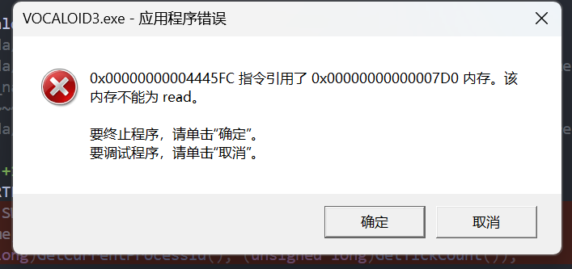
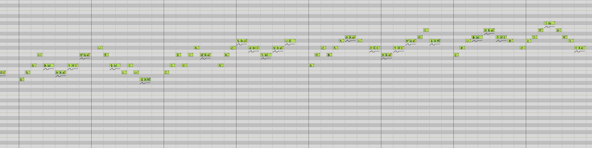
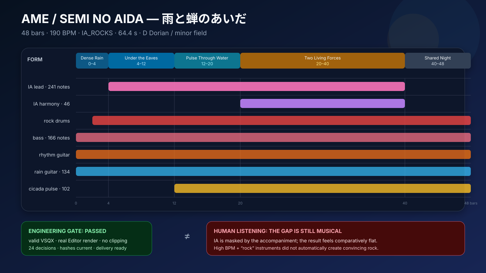
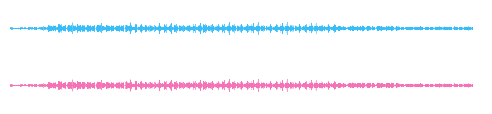
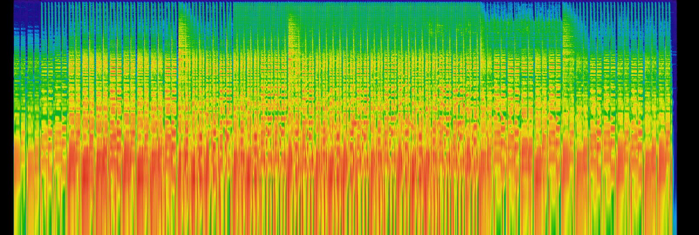

# Just for Fun: We Told a Coding Agent to Make VOCALOID Songs, and Things Got Out of Hand

## A story involving IDA, MCP, IA, Win32 dialogs, music theory, swordsmen, summer nights, rain, cicadas, and “it still does not rock”


> It really did begin as just for fun.

We had VOCALOID3, IA and IA_ROCKS, a coding agent running inside WSL, and one extremely irresponsible but irresistible question:

> Could Codex make a Vocaloid song by itself?

If we had quietly defined “make a song” as “export MIDI,” the project could have ended in an afternoon.

Unfortunately, we did not.

We wanted native VSQX, Japanese lyrics and phonemes, IA's real voice, accompaniment, stems, mixing, mastering, an export from the actual VOCALOID3 Editor, a project that still opened afterward, and a complete record of why each line had been sung that way.

The fun project quickly became:

```text
TypeScript MCP server
+ 32-bit native Windows helper
+ Win32 UI automation
+ Yamaha schema / native loader
+ canonical song database
+ music-theory analyzer
+ Japanese mora allocator
+ audio production graph
+ creative-decision hash chain
+ several gigabytes of local experiments
+ many, many Save As dialogs
```

We did eventually produce complete songs.

We also found a more interesting answer: **engineering can make an agent finish a song; it cannot yet make the agent consistently write a masterpiece.**

---

## Act I: do not fob us off with MIDI

A VOCALOID performance is more than note number and duration. It contains lyrics, language-specific phonemes, singer identity, consonant timing, accent, decay, opening, bends, portamento, vibrato, master controls, parts, pre-measures, mixer state, and singer events.

Our first rule was therefore simple: no stealing a template from an existing VSQX, changing a few notes, and calling it AI composition. The agent had to create a native project from a blank state.

The first tiny victory looked like this:


The screenshot is wonderfully unglamorous: three notes, a valid IA_ROCKS singer, and an Editor willing to open the file.

Before that moment we had read the VOCALOID3 manual, studied the VSQ3/VSQ4 schemas, opened 32-bit DLLs in IDA, written a native-loader probe, worked through an MSVC 2008 ABI, walked Yamaha's object tree, and wrongly blamed the phoneme `4 a`—only to learn that `4` is VOCALOID's official Japanese flap/tap phoneme.

Software engineering is sometimes spending half a day suspecting one digit before the manual calmly tells you it has always been legal.

## Act II: we almost called VOCALOID's synthesis DLL directly

IDA revealed an enticing route:

```text
VSQX
  -> musical part
  -> Daisy MIDI buffer
  -> CRtSynthesis
  -> DSE3
  -> 256-sample render frames
  -> WAV
```

We reached VSQX loading, time-map creation, Daisy encoding, DSCL3/DSE3 loading, and synthesis-export resolution. Then the engine returned `-100` at the voice-database and registration boundary.

There were two choices: keep digging into activation and licensing, or stop and use the original Editor, which legitimately possessed the complete voicebank context. We stopped.

That was not a failed reverse engineering exercise. It was one of its best outcomes: knowing where to stop, and being able to explain why the production architecture should move one level upward.

## Act III: ancient desktop software is the final boss

VOCALOID3 Editor is not an API server. It opens modal dialogs, waits for a Save As filename, remembers or forgets its previous path, exports for a long time, remains alive after it appears to have closed, and occasionally throws an access violation during cleanup.



UI automation became a transaction protocol:

```text
fingerprint editor
  -> acquire host-wide lease
  -> launch exact project
  -> verify singer / dialog state
  -> invoke Export Wave
  -> discover a fresh Save dialog
  -> validate parent + filename
  -> submit
  -> wait with a progress-aware timeout
  -> verify WAV structure + non-silence + digest
  -> close only the owned process
  -> release lease
```

“A file appeared” is not success. Partial exports, zero-byte output, silence, singer fallback, and stale dialog handles must all fail closed.

One export repeatedly stalled at the end because the Save As dialog had no filename. Another claimed the path did not exist because a legacy Windows application had received a bizarre path. None of these bugs had anything to do with composition, but any one of them could keep a finished song trapped forever.

## Act IV: an XML writer grows into a small production system

VSQX is a good delivery format for the Editor and a bad sole database for an agent. It does not naturally retain renderer choices, effect chains, artifact hashes, reviews, dependencies, mutation history, creative intent, or the question an A/B test is meant to answer.

`.song.json` became the canonical source of truth. Each mutation carries a monotonic revision, stable IDs, composition/mix/content hashes, a parent hash, dry-run evidence, atomic writes, backups, and provenance. VSQX, backing, stems, mixes, analyses, and mastered WAVs are derived artifacts.

That does not sound much like “just for fun,” but it enables something genuinely fun: the agent can revise one chorus line without resending three thousand events or letting an old WAV impersonate the current song.

## Act V: the first complete songs

Before the composer-intent phase, the pipeline closed three IA_ROCKS styles:

| Work | Direction | Length |
| --- | --- | ---: |
| `花色日和` | wa-rock | 4:16 |
| `火花の航路` | driving J-Rock | 2:06 |
| `夏の夜に浮かぶ声` | summer-night dream pop | 3:18 |

Each had lead and harmony, multiple instruments, stems, mix, master, loudness/dynamics/peak/clipping QC, and a matching VSQX. The checkpoint proved that an agent-native pipeline could deliver a complete song.

Then we finally asked, with uncomfortable seriousness:

> What is it actually trying to sing?

## Act VI: the engineer steps back so the composer can appear

The next phase revolved around one sentence:

> Stop asking, “Can it sing?” and begin asking, “What, exactly, do I want IA to sing out in this line?”

The repository gained composition intent, section transitions, anchor phrase directions, listening questions, deterministic theory, bounded repairs, phrase grammar, short audition ladders, creative journals, three kinds of freshness, and four evidence levels: declared, materialized, rendered, and heard.

A line now follows:

```text
Why does it exist?
  -> What must change inside the sentence?
  -> Which word is the semantic focus?
  -> How do melody, duration, and harmony serve it?
  -> How should IA bite, brighten, and withdraw?
  -> Which instruments enter, and which must move aside?
  -> Does it work in solo / harmony / minimal-band auditions?
```

Theory can locate crossings, breath risk, register crowding, and chord conflict. It cannot tell us whether a line is heartbreaking. That limit is a contract, not a TODO.

## Act VII: hundreds of local IA songs that the production agent cannot see

The drive contains hundreds of IA tracks. We initially imagined a comprehensive corpus profile: tempo, form, harmony, F0, vocal performance, aggregate ranges, and novelty audits.

The danger becomes clear quickly. If an agent can query a nearest melody, next note, or per-track contour, a “style system” eventually slides into an imitation system.

We made a decision that looks restrictive and is actually liberating:

```text
the production agent cannot see the corpus
```

The library may only help a maintainer notice that the phrase vocabulary lacks a broadly useful choice. The abstraction must be human-reviewed, free of source identity, non-reconstructive, and contain no melody, chord, lyric sequence, or next-note hint.

The agent sees `delayed entry`, `late peak`, `semantic breath`, and `modal pivot`—never “copy what happens at 0:27 in this song.”

## Act VIII: melodies really do turn into staircases

After a cold-start agent wrote `遠い灯、青い夜`, we opened its VSQX:



It was not random. It was painfully tidy: rise, fall, rise, fall; every phrase began in the same place; 97.9% of comparable motion was small stepwise motion.

Phrase grammar was born from this screenshot. We explicitly forbid it from compiling melody, because solving “the agent is too templated” by giving it more templates merely creates a larger template library.

The DSL can ask whether a line is a statement or answer; whether it begins on the downbeat, as a pickup, late, or offbeat; whether it forms an arch, terrace, plateau, or asymmetric wave; where the semantic breath belongs; and whether development uses repetition or fragmentation. The final notes still belong to the agent.

## Act IX: “tuning intent exists” and “the VSQX is tuned” are different claims

One audit found a manifest declaring dynamics, opening, focus vibrato, and a pitch fall-away while the final VSQX contained none of the matching controls. It was the musical equivalent of writing “the singer should tremble on the final line” in a production note and forgetting to record it.

Evidence was split into:

```text
declared -> materialized -> rendered -> heard
```

The `apply_tuning` compiler must truly turn gestures into note styles and native PIT/PBS/DYN/BRI data. Without materialization provenance, build stops.

The funny part is that the song already sounded better before those fancy controls arrived. Lyrics, contour, mora timing, harmony, silence, and restrained arrangement were doing the real work. Automation cannot impersonate composition.

## Act X: can a completely new agent take over?

We launched a fresh `gpt-5.6-sol`/`xhigh` session, forbidding access to the corpus, older songs, and old compose scripts. Its first intent described two swordsmen passing on a cliff.

It wrote `風は名を呼ばない`, treating IA as the nameless mountain wind:

- original IA;
- 3:10;
- 68 bars;
- 433 vocal events;
- 23 decisions;
- a real Editor render.

The framework transferred successfully. The agent also found a parade of timeout, dead-lease, Save As, journal retry, false phrase-entry, and endpoint-trend bugs. Perfect. A useful benchmark does more than pass or fail; it points directly at the next engineering work.

## Act XI: one fixed prompt plus one intent file

To free the next session from chat history, composition now begins with:

```text
prompts/vocaloid-composition-agent.md
+ intents/<song>.intent.json
```

The intent can specify:

```json
"tempo_bpm": { "min": 180, "max": 200, "preferred": 190 }
```

It also carries exact voicebank component, duration, genre, must-avoid constraints, listener question, and source boundaries. The next agent reads a strict, validated, hashable contract—not the previous agent's mood.

## Act XII: summer night, rain, cicadas, IA_ROCKS, 190 BPM!

The final experiment deliberately requested 180–200 BPM, IA_ROCKS, and rock. A new session delivered `雨と蝉のあいだ`:

- 190 BPM;
- 48 bars and 64.4 seconds;
- 287 vocal notes;
- drums, bass, rhythm guitar, rain guitar, and cicada pulse;
- 24 hash-chained decisions;
- valid VSQ3 and original-Editor render;
- -16.3 LUFS, -1.2 dBTP, and no clipping.



Its waveform looks exactly like a “finished song”:



The spectrogram is suitably busy:



Then human ears said:

> The accompaniment completely buries IA.

And:

> It is still rather flat. It does not really feel like rock.

Perfect.

Not a perfect song—a perfect experiment. Those two comments cleanly separate engineering completion from musical completion.

## Act XIII: 100 passing tests cannot argue with ears

The final repository result was:

```text
102 tests
100 passed
2 skipped by environment
0 failed
```

The song was valid, current, non-silent, unclipped, hash-verified, reproducible, and documented. If the listener cannot hear IA, however, the test suite does not get to answer, “but the vocal-presence metric is green.” If it does not sound like rock, `primary_genre: rock` does not alter the audio.

This became our favorite project rule:

> Metrics may disprove a mistaken technical hypothesis. They may not overrule a real listening experience.

## Boss-fight ledger

| Boss | Loot |
| --- | --- |
| `4 a` falsely rejected | manual-backed phoneme regression |
| direct DSE `-100` | a clear licensing boundary |
| VOCALOID cleanup crash | owned-process teardown protocol |
| Save As without a filename | fresh-dialog retry and path diagnostics |
| export timeout | progress-aware 900-second client |
| dead Editor lease | PID/liveness-aware reclaim |
| identical IA/IA_ROCKS probe digests | singer-identity collision guard |
| tuning intent absent from VSQX | materialization compiler and preflight blocker |
| every melody phrase rises and falls | phrase grammar and concentration analyzer |
| D-Dorian C called a leading tone | semitone-aware modal rule |
| sparse harmony reported as 46 crossings | overlap-weighted voice ordering |
| F0 tracker selects second harmonic | an honestly open limitation |
| mastering sounds sharper | equal-loudness A/B and transparency metrics |
| accompaniment masks IA | a real mix problem that automation has not solved |
| 190 BPM still does not rock | a real musical problem engineering has not solved |

## So what is the agent now?

It is already a good composer assistant, arrangement-hypothesis generator, Japanese note-allocation worker, production engineer, test operator, A/B machine, obsessive archivist, and teammate who can watch a VOCALOID export at midnight.

It is not a taste oracle, a rock band, a mixing engineer's ears, a producer's cultural memory, or a hit-song compiler.

## What remains in the repository

We do not pour every WAV into Git:

```text
artifacts/songs/             local-only final listening WAVs
artifacts/evals/             local-only stems / A-B / debug / traces
build/                       local-only working state

artifacts/vsqxs/             tracked native projects
artifacts/creative-records/  tracked manifests / journals / reports / digests
notes/                       tracked contracts and failure evidence
blogs/                       tracked long-form story
```

The public repository can prove what happened without becoming a three-gigabyte audio truck.

## If you want to play too

The smallest entry point is:

```bash
npm install
npm test
npm run build
```

Generate a fixed-workflow, intent-specific agent prompt with:

```bash
npm run --silent compose:prompt -- --intent=intents/template.intent.json
```

You need your own legitimately licensed VOCALOID3 Editor and voicebank for original-Editor synthesis. The repository contains no voicebank, license data, or final WAV.

Most importantly, prepare one line that you genuinely want to hear IA sing. Not merely, “make me a rock song,” but:

> Before this line appears, what state is the world in? After IA sings it, what should have changed?

That question is much harder than BPM.

It is also much more fun.

---

## Ending

The project traveled from a 32-bit vtable in IDA to IA singing about rain and cicadas in a 190 BPM summer night. In between were native loaders, UI crashes, hard-left pan, silent fallback, LUFS, Dorian, swordsmen, mountain wind, Save As, hash chains, and many moments of “I am crying; I cannot hear the difference XD.”

At the beginning, the goal was probably: “Let an agent make a Vocaloid song, just for fun.”

Now the answer is:

> We built an unusually serious, auditable Vocaloid production machine that finds its own bugs, records every decision, and occasionally writes a passage with real feeling.

It still cannot reliably write masterpieces.

But it is remarkably well suited to making music together with a person.

And honestly—that is already fun enough.
